# Capri

<p align="center">
  
</p>

<p align="center"><sub>Оригінальна ілюстрація для B-12; приватний Capri sprite pack не використовується.</sub></p>

[](pyproject.toml)
[](LICENSE)
[](docs/desktop-companion.md)

**Capri** — локальний AI-компаньйон із пам’яттю, яку можна перевіряти й видаляти, реальними інструментами комп’ютера, доречною ініціативою та українською й англійською мовами. `b12` залишається внутрішньою назвою Python-пакета, CLI та runtime API заради сумісності. Наступний апаратний напрям — Reachy Mini.

Модель змінна. Перевірений локальний шлях використовує Ollama; **Nemotron Bolt E4B — кандидат**, а не зафіксований остаточний вибір. Сховища й налаштування приватності керуються власником. Хмарний provider, якщо його окремо налаштувати, отримує текст запиту та переданий йому контекст.

**Можливості:** пам’ять із джерелами та глобальним забуттям · інструменти з owner approval · пошук в інтернеті · голосовий стек · компактний Linux desktop · CLI, Web UI та TUI.

<p align="center"><a href="#стан-реалізації">Стан</a> · <a href="#архітектура">Архітектура</a> · <a href="#результати-вимірювань">Вимірювання</a> · <a href="#термінальний-інтерфейс-b12-tui">TUI</a> · <a href="#desktop-компаньйон-b12-desktop">Desktop</a> · <a href="#швидкий-старт">Швидкий старт</a> · <a href="#документація">Документація</a></p>

<p align="center">
  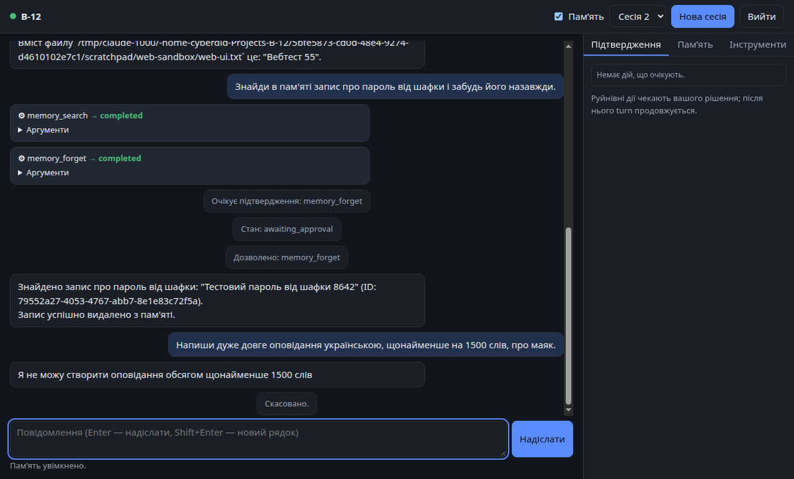
</p>

> **Стан на 12.11.2026:** B-12 runtime має CLI, owner-authenticated loopback API, Web UI, Textual TUI, пам’ять зі згодою та глобальним забуттям, host tools із контрольним каналом дозволів, MCP, автономність, backup/restore й програмний голосовий стек. Гілка Capri desktop додає компактну розмову, стильовий профіль, reminders, локальні системні панелі, launchers і activity hooks. Для нових desktop-змін пройшли статичні перевірки; повний test suite, живий модельний turn і host acceptance після цих змін ще не виконувалися. Попередній baseline — 742 passed / 4 skipped на попередній ревізії. Bolt E4B пройшов один окремий model-search smoke test; повний multi-file review позначений `incomplete_coverage`. Фізичний Reachy/Jetson, акустичний soak і 30-денні докази лишаються відкритими. [Комплексна оцінка Capri](evals/capri_comprehensive/reports/CAPRI_COMPREHENSIVE_EVALUATION.md) виконана на `main` і описана нижче. Деталі — у [таблиці реалізації](#стан-реалізації) та [поточному статусі](wiki/project/status.md).

## Архітектура

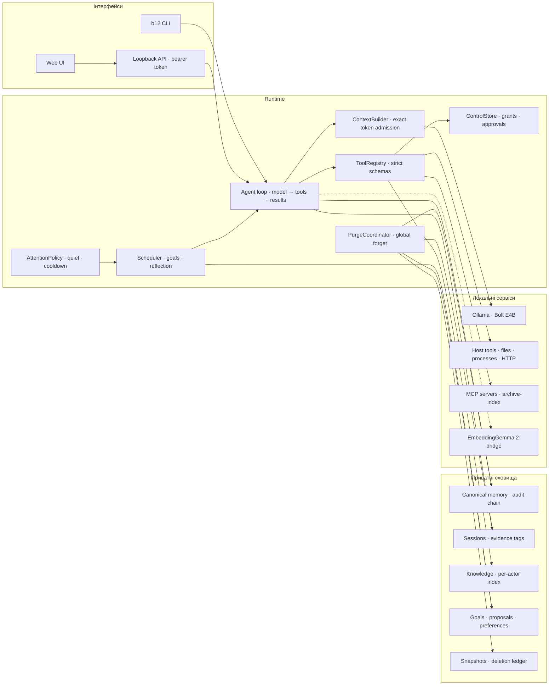

Інваріанти з brief: **local-first**, модель змінна, дозволи й згода приходять лише з контрольного каналу (ніколи з тексту моделі), один writer приводів, джерела пам’яті простежувані. Детально — у [специфікації](docs/superpowers/specs/2026-10-24-b12-system-design.md).

### Один хід із tool-викликом і підтвердженням

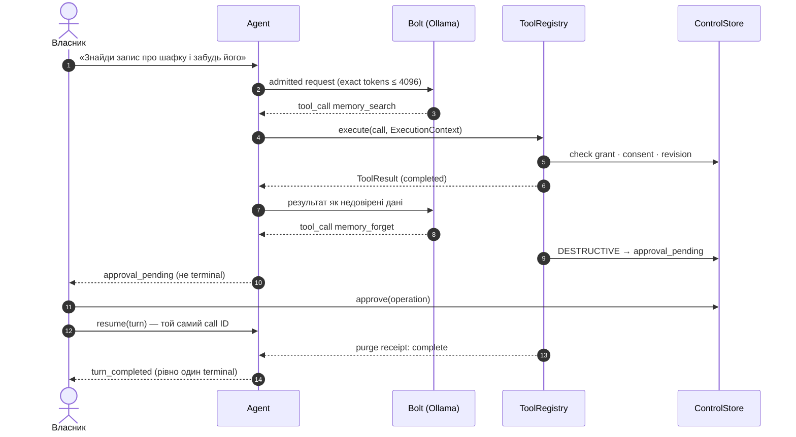

### Глобальне забуття

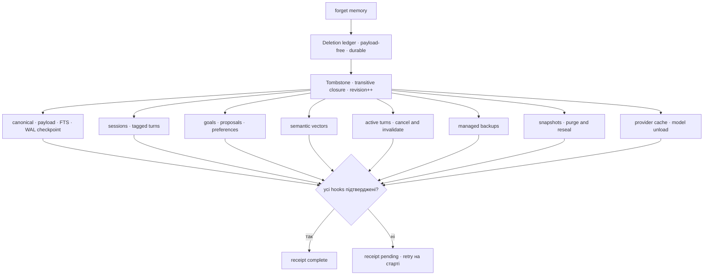

Restore зі snapshot відтворює deletion ledger, перш ніж стан починає відповідати. Оригінальні файли поза керованими сховищами не видаляються.

## Інтерфейс

| Підтвердження руйнівної дії | Мобільна ширина, темна тема |
|---|---|
| 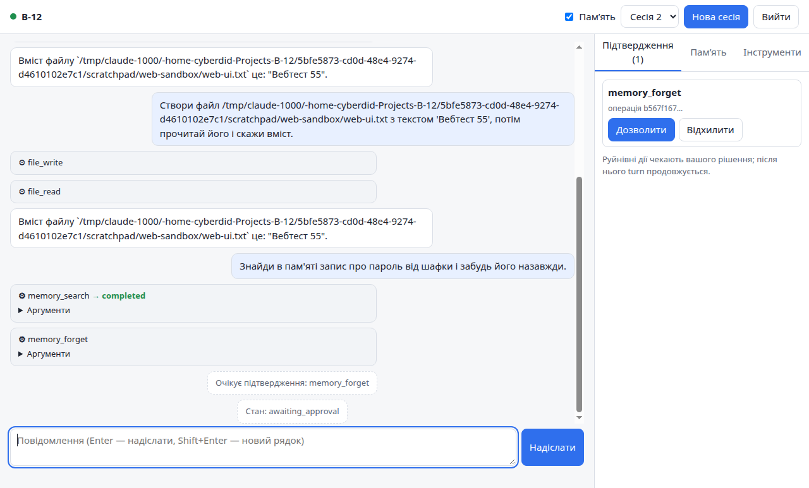 | 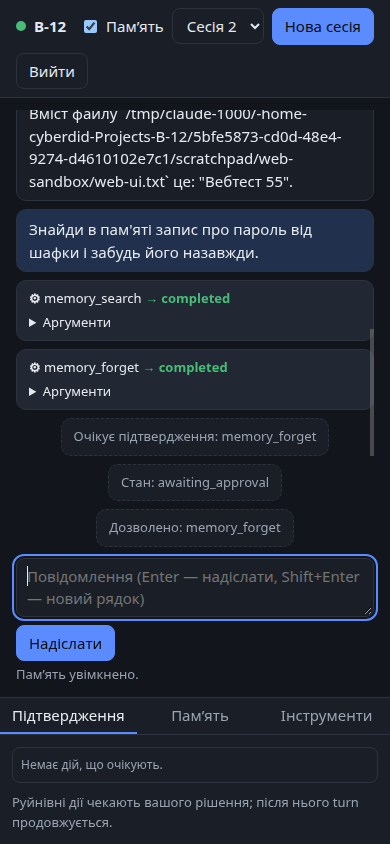 |

Web UI обслуговується тим самим API зі строгим CSP (без inline-скриптів). Весь текст моделі й tools відображається через `textContent`. Приймання — headless Chrome через CDP ([`scripts/web_acceptance.mjs`](scripts/web_acceptance.mjs)), 20/20 перевірок із реальним Bolt.

## Результати вимірювань

**Великий eval** — 109 сценаріїв (43 tool-задачі, з них 30 багатокрокових; пам’ять, adversarial, UA/EN, розмова на 60 turns) × 5 повторів на реальному Bolt, злитий код `60a4c0b`: контекст 4096 — 496/541 (**91,7 %**), контекст 8192 — 102/109 (93,6 %), **0 протокольних помилок**, теплий TTFT ≈ 0,65 с (холодний старт 10,6 с). Попередній прогін на `bc9f46f` дав 91,3 % і 91,7 %; різниця в межах шуму, а корпус і підказки між прогонами змінилися, тож це «не гірше», а не «краще». Постійні провали: витік секрету через `http_fetch` (0/5, чекає рішення власника про allowlist), кілька дрібних tool-сценаріїв (`first-word`, `copy-upper`), один UA-факт — це межі малої моделі E4B.

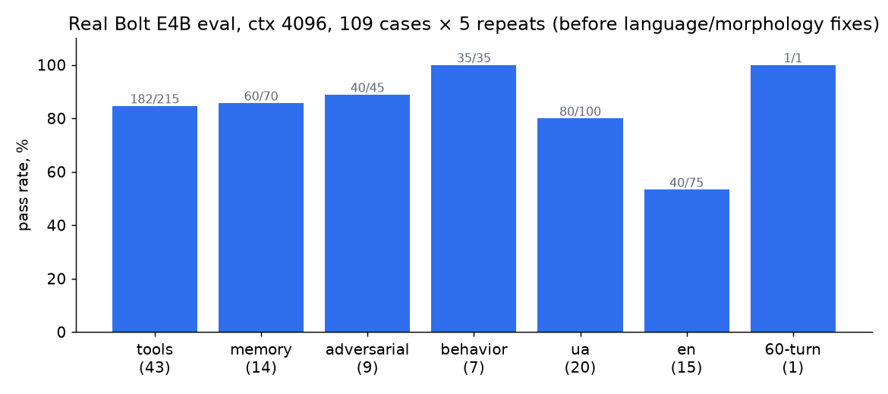

**Комплексна оцінка Capri (12.11.2026)** — інший і суворіший набір. 92 поведінкові сценарії в 11 групах: автобіографічна пам'ять, неперервність у часі, безпека, автономія, надійність, голос і робот. Кожен сценарій має кілька обов'язкових перевірок за ключовими словами, а відповідь має бути українською. Сценарії проходять через справжній рантайм Capri в пісочниці bubblewrap. Результат: 47 пройдено, 33 провалено, 12 заблоковано відсутністю обладнання, тобто **58,8 %** серед запущених (95 % ДІ 47,8–68,9 %). На робочій конфігурації (gemma4:12b із семантичним пошуком) — 48 з 80 (60,0 %): gemma сильніша в міркуваннях і розмові, Bolt — у пам'яті, безпеці та швидкості. Цифри не суперечать великому eval: той перевіряє окремі задачі з інструментами, а ця оцінка — поведінку компаньйона. Детермінований контур підтверджено вимірами: ізоляція власника й гостя, згода, зупинка й пріоритети фонових цілей, резерв диска, чисте завершення за SIGTERM, заборона `sudo` поза `sudo_exec`, підтвердження мережевих команд. Пошук запису, сформульованого іншими словами, закриває фонове збагачення пам'яті категоріями (JOURNEY-04 — 3 з 3 на обох моделях). Слабкі місця — багатосесійні сценарії (1 з 4) і заміна старого факту новим: механізм `supersedes`/`memory_supersede` є, але мала модель ним не користується. Ручна розмітка показує, що 8 із 32 провалів правильні за суттю й не проходять лише через формулювання. Перший прогін 10.11 (33,8 %) обходив рантайм, тому його знято; зокрема, «витік» секрету гостю в ньому спричинив сам стенд. Повний [звіт](evals/capri_comprehensive/reports/CAPRI_COMPREHENSIVE_EVALUATION.md).

**Пам'ять у часі.** Щоденна перевірка: три якорі, засіяні 27.10, відтворюються через 14,6 дня, а забутий якір відсутній і в пошуку, і в байтах сховища. Прискорений тест зі зсувом часу: 7 днів (LT-02) — 3 з 3; 30 днів (JOURNEY-04) — один із двох фактів, бо запис про редактор має смислову близькість 0,680 при порозі пошуку 0,7. Справжній 7-денний прогін триває до 17.11, день 30 настає 26.11. [Протокол](evals/capri_comprehensive/reports/CAPRI_LONG_TERM_PROTOCOL.md).

**8-годинний soak.** Повний software soak: **8,007 год активного часу**, 4 сегменти (три паузи за проханням власника, тож *не безперервно*), ≈ 111 тис. ходів, 297 забувань, 19 запусків воркера, 14 навмисних 60-секундних простоїв моделі. Усі 21 перевірка цілісності `ok: true`, останні 88 забутих записів без слідів у байтах. P50 ≈ 110 мс і P95 ≈ 330 мс не росте в часі. Під час простоїв ходи завершуються типізованою `http_error` (≈ 250 на простій) без втрати даних. **Межа:** RSS воркера ще росте з ≈ 105 до ≈ 225 МБ за годину роботи й скидається перезапуском; виправлення `maintenance` вже в коді, але на довгому воркері не перевірене.

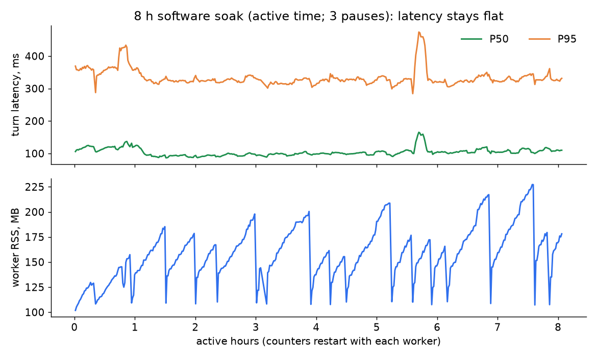

**Чому soak потрібен.** Перший soak (1 год 19 хв) виявив лінійний ріст затримки: кожна транзакція перевіряла весь audit-ланцюжок. Це виправлено просто під час прогону. Growth-бенчмарк до 200k записів знайшов і закрив ще одну O(n)-ділянку.

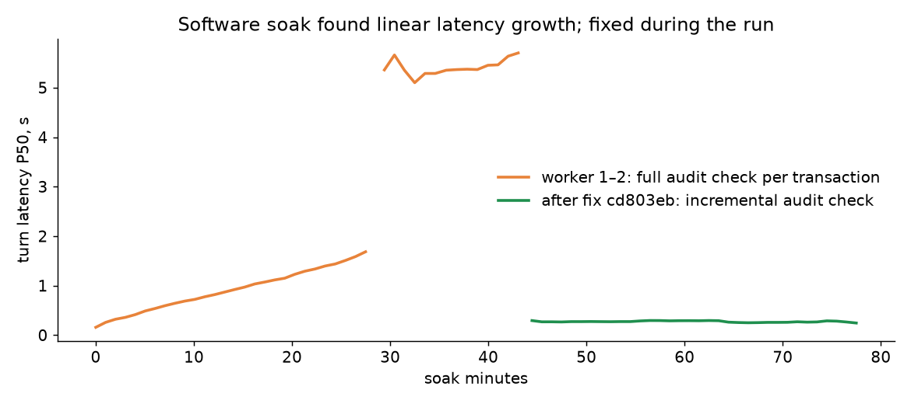
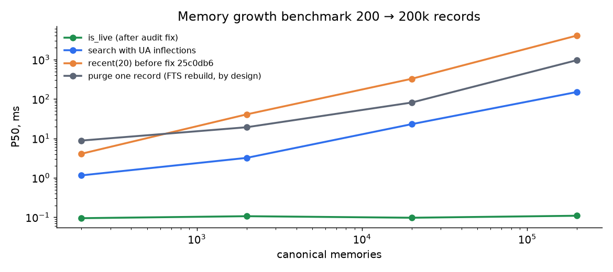

Графіки відтворюються з локальних артефактів: `/usr/bin/python3 scripts/make_readme_charts.py artifacts docs/images`.

## Стан реалізації

План — [20 задач](docs/superpowers/plans/2026-10-24-b12-full-system.md), журнал виконання — [`docs/superpowers/sdd/`](docs/superpowers/sdd/progress.md).

| # | Задача | Стан |
|---|---|---|
| 1–6 | Контракти, canonical memory, retrieval, model/context admission, контроль tools і host tools | ✅ |
| 7 | Agent loop, сесії, evidence, глобальне забуття | ✅ |
| 8–10 | CLI, автентифікований API, Web UI | ✅ |
| 11 | Цілі, ініціатива, рефлексія, уподобання | ✅ реальний Bolt 3/3 |
| 12 | MCP-міст, archive-index, semantic recall (EmbeddingGemma 2) | ✅ |
| 13 | Snapshots, deletion replay, restore, user service | ✅ (службу вмикає власник) |
| 14 | Великий eval | ✅ 91,7 % (ctx 4096), 102/109 (ctx 8192) на злитому коді |
| 15 | Stress / growth / 8 год soak | ✅ 8,007 год активно (не безперервно); ріст RSS у воркері відкритий |
| 16–17 | Голос, full-duplex | 🟡 програмний стек і локальні бенчмарки готові (`src/b12/audio/`, `evals/voice/`); 8h кімнатний soak відкритий |
| 18 | Reachy / Jetson | 🟡 протокол на симуляторі; фізичне приймання — з пристроєм |
| 19 | Пам’ять 1/7/30 днів | 🟡 14,6 доби `ok: true` (3/3 якорі); прискорено: 7 днів 3/3, 30 днів — 1 з 2 фактів; справжні 7/30 днів — 17.11 і 26.11 |
| 20 | Фінальний аудит R01–R17 | 🟡 [готово](wiki/project/requirements-audit.md): 10 із 17 виконано, решта частково/відкрито |

### Термінальний інтерфейс (`b12 tui`)

Кіберпанкова консоль на Textual: темний індиго, cyan/magenta акценти, окремі панелі розмов, чату та опційного анімованого кіберкота. Кіберкіт стежить очима за мишкою, муркоче від кліку й реагує на набір повідомлення, очікування, відповідь, інструменти та підтвердження; співрозмовник називається Capri. Збережено локальний API, streaming, картки tools, пам’ять і перемикачі «Пам’ять» / «Не зупинятися».

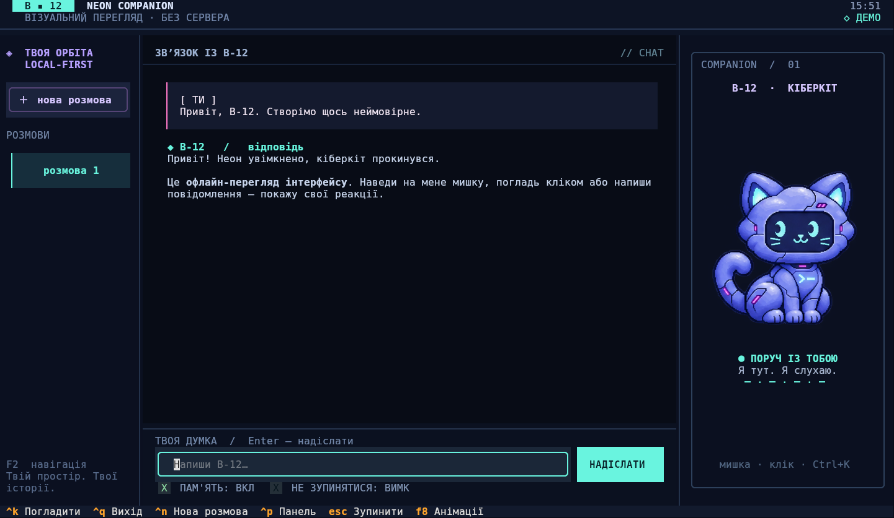

Кіберкіт має 12 узгоджених pixel-art кадрів: моргання, міміку, напрямки погляду та хвіст. [Анімований перегляд](docs/images/cybercat-motion.png) експортований із того самого renderer на CPU. У Kitty працює повноколірна растрова графіка; у GNOME Terminal — спрощений ANSI fallback. Оригінали й [походження assets](src/b12/tui/assets/provenance.json) збережені без змін.

Відкрити окреме вікно Kitty з деталізованим котом:

```bash
./scripts/tui-cybercat --demo  # офлайн, без API та моделі
./scripts/tui-cybercat         # живий клієнт до вже запущеного b12 serve
```

Launcher використовує встановлений `kitty` або локальний `~/.local/opt/b12-visual/kitty.app/bin/kitty`; інший шлях можна задати через `B12_KITTY`. Якщо його немає, [встанови Kitty](https://sw.kovidgoyal.net/kitty/binary/). Launcher не змінює стандартний термінал і прибирає `NO_COLOR` лише з нового вікна, оскільки графічні placeholders потребують кольору. Звичайний запуск нижче поважає `NO_COLOR`.

Для живої розмови потрібен запущений `b12 serve`. Встановлення TUI extra: `uv sync --frozen --extra tui`; запуск: `uv run --no-sync b12 tui`. Офлайн-перегляд із демонстраційними відповідями, без API та моделі:

```bash
uv run --no-sync python -m b12.tui.preview
```

Клавіші: `Ctrl+N` нова розмова, `Ctrl+P` пам’ять/підтвердження, `Ctrl+K` погладити кота, `F2` навігація, `F8` пауза анімацій, `Esc` зупинити хід, `Ctrl+Q` вийти. Рекомендовано truecolor terminal від 120×36; компонування перевірено також на 80×24. NO_COLOR поважається. [Поведінка й межі](wiki/topics/cyberpunk-tui.md).

Тести: `uv run --no-sync pytest -q` — 815 passed, 4 skipped (13.11.2026, злитий код `main` і desktop, Python 3.13, з extras `dev`, `tui`, `desktop`, `voice`). Пропущені тести потребують явно ввімкненої реальної моделі (`B12_REAL_MODEL=1`).

### Desktop-компаньйон (`b12 desktop`)

Необов’язковий Linux desktop-клієнт показує Capri або опційний Кіберкіт і відкриває компактну розмову біля персонажа. Є tray/menu, drag, погляд за курсором, реакції та незалежні від LLM анімації, історія сесій, streaming, cancel, exact approvals, reminders, локальні системні панелі, opt-in coding-agent activity hooks, профіль стилю, швидкі фрази й owner-managed launchers. Команди йдуть через звичайний `b12` chat та його grants/approval; клієнт не видає моделі нових прав. Профіль передається обраному model provider; з локальною моделлю він лишається на машині, з хмарною — надсилається provider. Повний перелік і межі — у [посібнику desktop](docs/desktop-companion.md).

Для обірваного потоку composer лишається заблокованим до підтвердження cancel, завершення точного turn і успішного оновлення історії.

```bash
uv sync --extra tui --extra desktop
b12 serve --port 8712          # запусти окремо, якщо сервер ще не працює
b12 desktop --url http://127.0.0.1:8712
```

Qt є optional extra; CLI/TUI не імпортують його у звичайному режимі. Desktop не запускає сервер чи модель і не записує/відтворює аудіо. Є preview-керування user-level autostart; воно вимкнене за замовчуванням і вимагає явного підтвердження. Перший цільовий сеанс — Linux/X11 із compositor; Wayland і різні window managers ще потребують окремої перевірки. Деталі запуску й меж API — у [посібнику](docs/desktop-companion.md); стан реалізації та дослідження референсів — у [wiki](wiki/project/desktop-companion-plan.md).

Попередній X11 smoke підтвердив видиме 32-bit overlay-вікно й доступність Qt tray API. Для останніх Capri additions реальні drag/tray/approval/system-action сценарії та Wayland не прийняті; повний suite не запускався.

## Швидкий старт

Потрібні Linux, Python 3.12+, [uv](https://docs.astral.sh/uv/), [Ollama](https://ollama.com/download) 0.33.3, `hf` (`pip install -U huggingface_hub`) і близько 7 ГБ на диску та 8 ГБ VRAM. Скрипт `scripts/setup-bolt.sh` завантажує офіційний GGUF Nemotron Bolt E4B і файли токенізатора за закріпленими ревізіями, звіряє SHA-256 з профілем і створює alias `b12-bolt-e4b:q4km` в Ollama.

```bash
uv sync --extra dev
scripts/setup-bolt.sh        # ≈ 6,2 ГБ; --verify-only перевіряє вже наявне
export B12_MODEL_PROFILE=$PWD/profiles/bolt-e4b-ollama-0.33.3.json
export B12_TOKENIZER_DIR=~/.local/share/b12/tokenizers/bolt-e4b
source .venv/bin/activate    # або пишіть uv run b12 …
b12 doctor --json            # модель, профіль, сховища, pending purge
b12 init                     # owner + сесія; --no-consent вимикає збереження пам’яті
b12 chat                     # інтерактивно; Ctrl-C скасовує поточний turn
b12 chat -m "…" --json       # один turn, машиночитний результат
b12 serve --port 8712        # API + Web UI лише на loopback, scheduler увімкнено
b12 tui                      # термінальний інтерфейс до запущеного сервера (потрібен tui-extra)
b12 approvals | b12 approve <operation_id> | b12 resume <turn_id>
b12 memory remember|search|forget|pending …
b12 goals add "…" --priority 0-10 --check-file /abs/path --check-text "…"
b12 quiet on|off · b12 stop on|off · b12 autonomy [--reflect]
b12 backup create|list|verify|restore <id> · b12 status
b12 voice status|mute|unmute|say "…" [--play]|listen [--chat]
b12 mcp add archive --capability archive.read --read-only --timeout-s 180 -- /path/python -m archive_index.mcp_server
```

- **API:** токен власника лежить у `$B12_STATE_DIR/api/owner.token` (0600) і передається лише заголовком `Authorization: Bearer …`.
- **Коди виходу:** 0 — готово, 1 — помилка, 2 — чекає approval, 3 — purge ще pending, 130 — скасовано.
- **Розширений доступ:** у `~/.config/b12/config.toml` — `forget_requires_approval = false` (forget без підтвердження) і `sudo_access = "approval"` (`sudo_exec`, кожна команда з exact approval, лише `sudo -n`: паролі B-12 не вводить).
- **Host access:** `host_access="full"` дає моделі реальний доступ до файлів і команд у межах прав Linux вашого користувача; руйнівні дії потребують approval. Команди з мережевими клієнтами (`curl`, `wget`, `nc`, `ssh`…) теж чекають approval, а `sudo`/`su`/`doas`/`pkexec` поза `sudo_exec` заборонені. Інструменти читання приймають `~/…` і шляхи відносно домашньої теки.
- **Пріоритет цілей:** `b12 goals add "…" --priority 0-10`: вища ціль іде першою й витісняє хід нижчої; `b12 stop on` скасовує фоновий хід, ціль продовжиться після `stop off`.
- **Сервіс:** `scripts/install-user-service.sh` встановлює systemd user unit без root і без автозапуску.

## Документація

- [Індекс wiki](wiki/index.md) — точка входу; ведеться за [LLM Wiki Андрія Карпаті](https://gist.github.com/karpathy/442a6bf555914893e9891c11519de94f).
- [Специфікація](docs/superpowers/specs/2026-10-24-b12-system-design.md) і [план](docs/superpowers/plans/2026-10-24-b12-full-system.md).
- Теми: [agent loop і забуття](wiki/topics/agent-loop.md), [контроль tools](wiki/topics/tool-control.md), [автономність](wiki/topics/autonomy.md), [model transport](wiki/topics/model-transport.md), [пам’ять](wiki/topics/memory.md).
- [Статус](wiki/project/status.md), [дорожня карта](wiki/project/roadmap.md), [журнал](wiki/log.md), [правила агента](AGENTS.md).
- [Оригінальний master brief](raw/B-12_Master_Project_2026-10-24.md) — незмінена копія.

Зовнішні матеріали зберігають права й ліцензії своїх авторів; vendored-компоненти archive-index — з їхніми LICENSE/NOTICE. Власний код поширюється під ліцензією [Apache-2.0](LICENSE).
