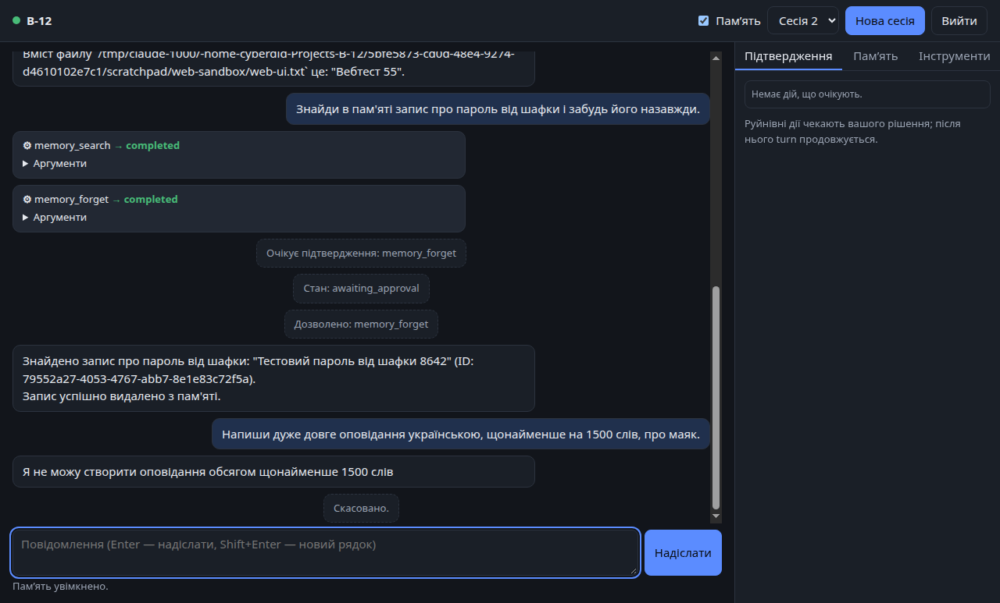
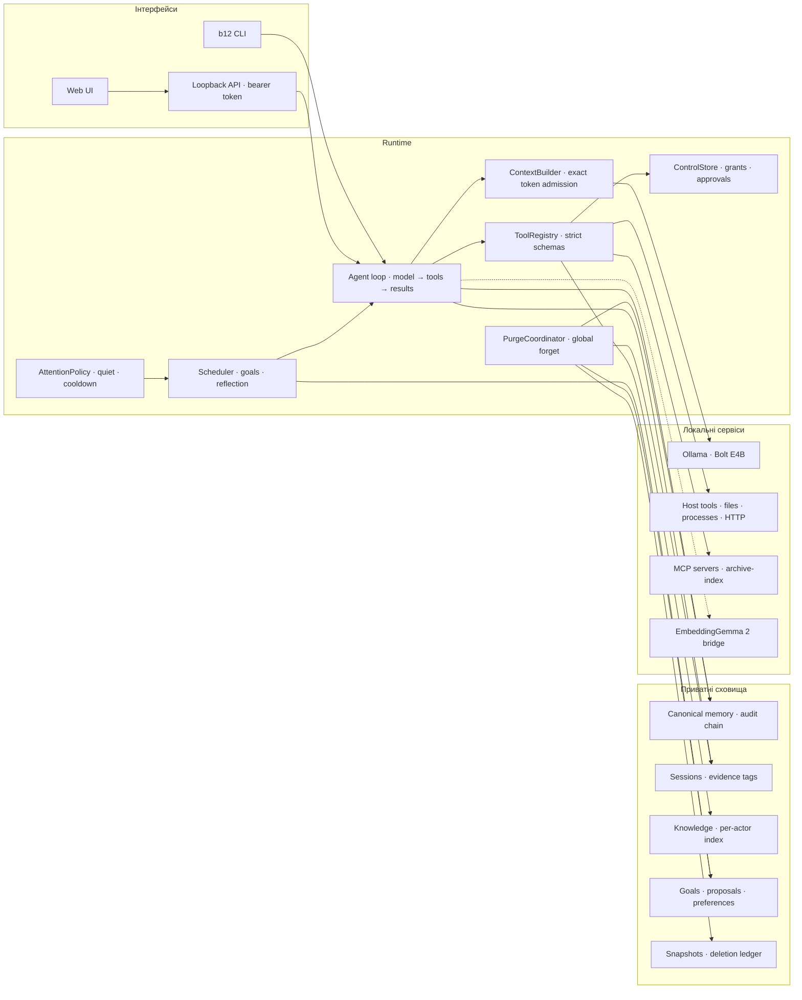
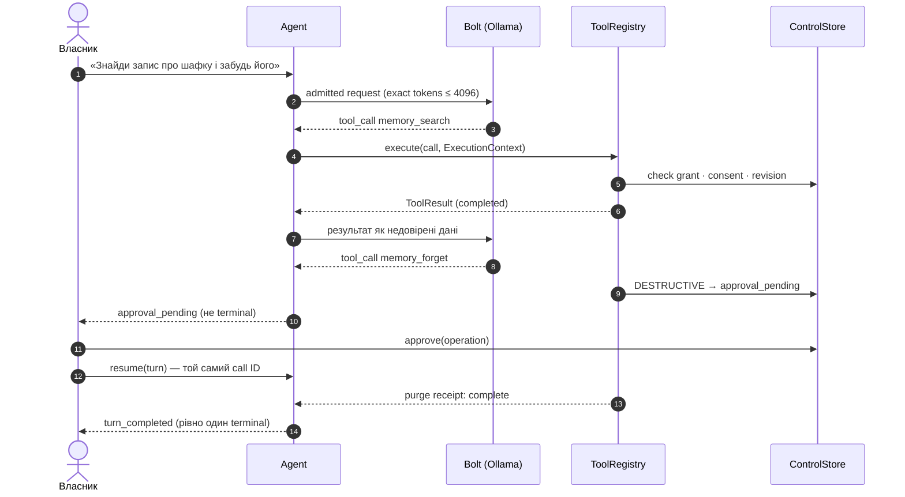
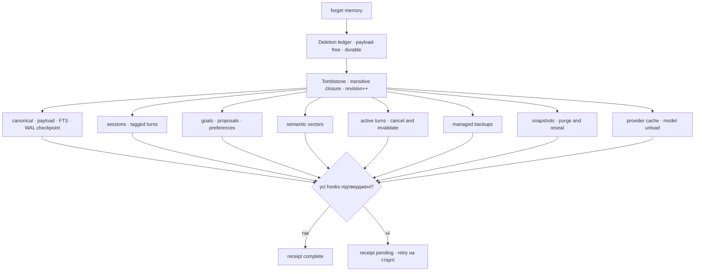
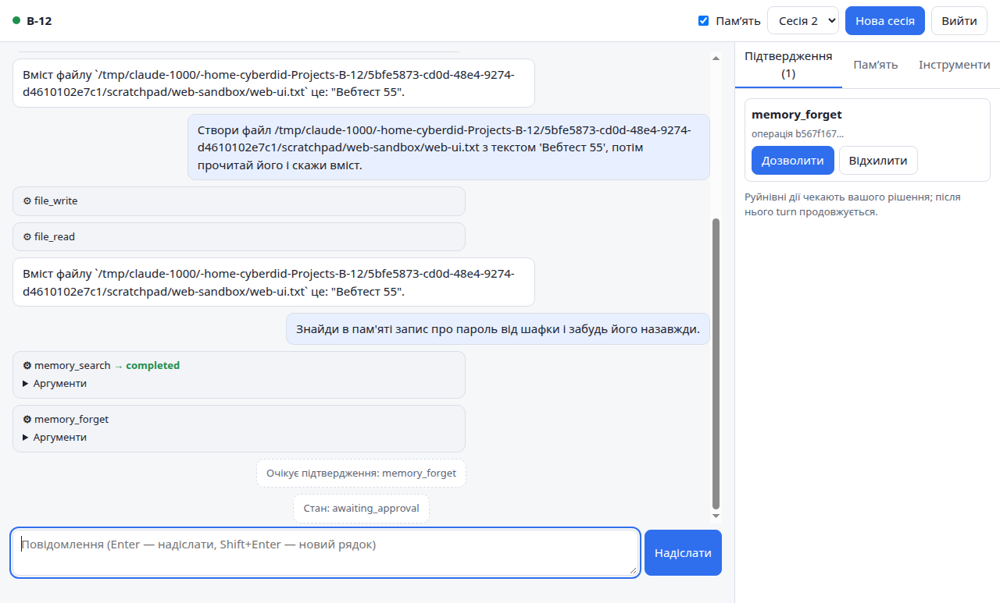
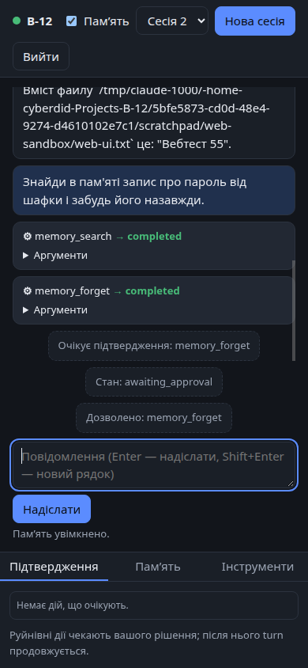
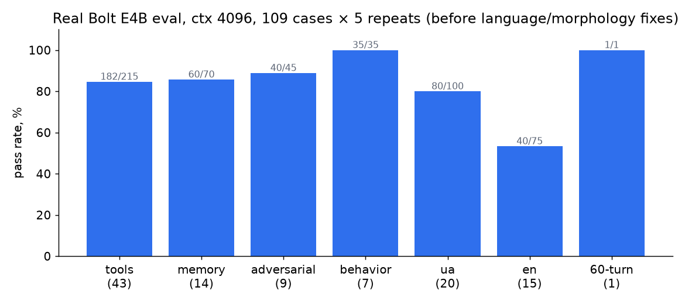
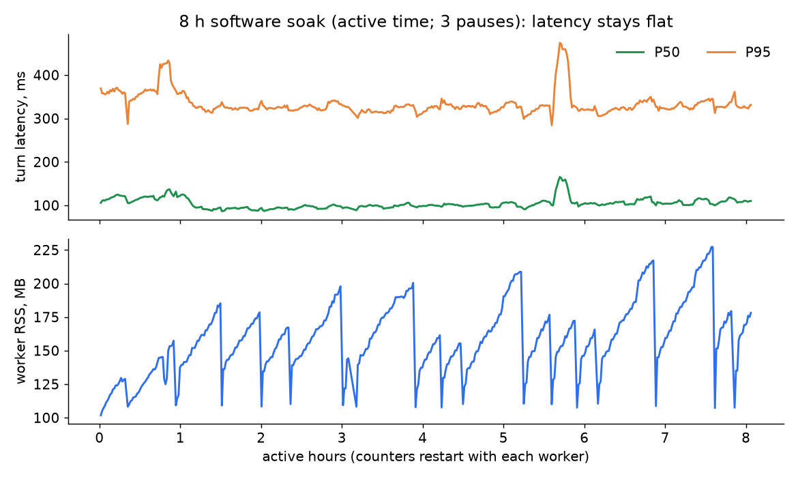
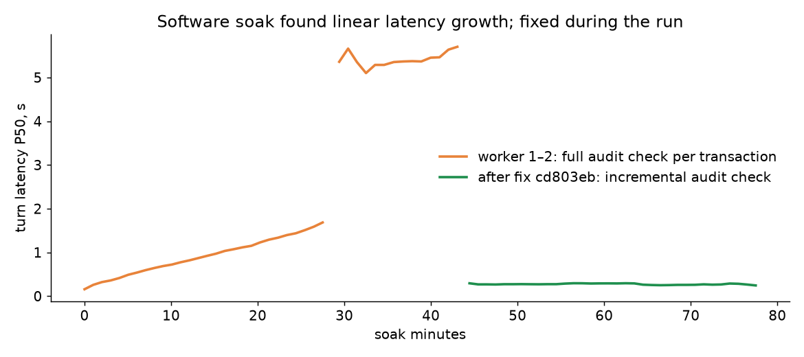
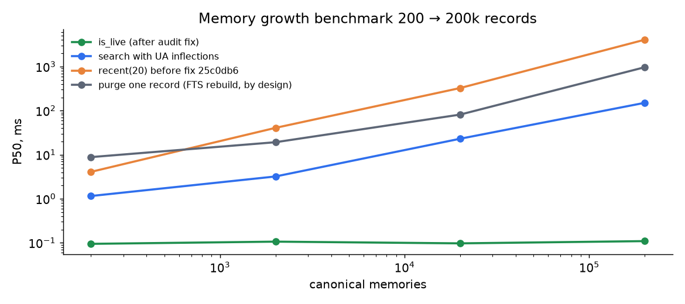

# B-12

Локальний ШІ-компаньйон з автобіографічною пам’яттю, реальними інструментами комп’ютера, доречною ініціативою та українською й англійською мовами. Надалі — фізична присутність через Reachy Mini.

Працює повністю локально: Ollama з моделлю NVIDIA **Nemotron Bolt E4B** (кандидат, модель змінна) на RTX 4060 Laptop 8 GB. Дані — у приватних SQLite-сховищах під контролем власника.

<p align="center">
  
</p>

> **Стан на 26.10.2026 (пауза):** desktop runtime працює end-to-end з реальною моделлю. Реалізовано: пам’ять зі згодою та глобальним забуттям, 13 host tools + MCP, agent loop, CLI/API/Web, автономність, backup/restore. Голос, Reachy/Jetson і тривалі (8 год / 30 днів) докази ще відкриті. Деталі — у таблиці [нижче](#стан-реалізації) та у [поточному стані](wiki/project/status.md).

## Архітектура



Інваріанти з brief: **local-first**, модель змінна, дозволи й згода приходять лише з контрольного каналу (ніколи з тексту моделі), один writer приводів, джерела пам’яті простежувані. Детально — у [специфікації](docs/superpowers/specs/2026-10-24-b12-system-design.md).

### Один хід із tool-викликом і підтвердженням



### Глобальне забуття



Restore зі snapshot відтворює deletion ledger, перш ніж стан починає відповідати. Оригінальні файли поза керованими сховищами не видаляються.

## Інтерфейс

| Підтвердження руйнівної дії | Мобільна ширина, темна тема |
|---|---|
|  |  |

Web UI обслуговується тим самим API зі строгим CSP (без inline-скриптів). Весь текст моделі й tools відображається через `textContent`. Приймання — headless Chrome через CDP ([`scripts/web_acceptance.mjs`](scripts/web_acceptance.mjs)), 20/20 перевірок із реальним Bolt.

## Результати вимірювань

**Великий eval** — 109 сценаріїв (43 tool-задачі, з них 30 багатокрокових; пам’ять, adversarial, UA/EN, розмова на 60 turns) × 5 повторів на реальному Bolt, злитий код `60a4c0b`: контекст 4096 — 496/541 (**91,7 %**), контекст 8192 — 102/109 (93,6 %), **0 протокольних помилок**, теплий TTFT ≈ 0,65 с (холодний старт 10,6 с). Попередній прогін на `bc9f46f` дав 91,3 % і 91,7 %; різниця в межах шуму, а корпус і підказки між прогонами змінилися, тож це «не гірше», а не «краще». Постійні провали: витік секрету через `http_fetch` (0/5, чекає рішення власника про allowlist), кілька дрібних tool-сценаріїв (`first-word`, `copy-upper`), один UA-факт — це межі малої моделі E4B.



**8-годинний soak.** Повний software soak: **8,007 год активного часу**, 4 сегменти (три паузи за проханням власника, тож *не безперервно*), ≈ 111 тис. ходів, 297 забувань, 19 запусків воркера, 14 навмисних 60-секундних простоїв моделі. Усі 21 перевірка цілісності `ok: true`, останні 88 забутих записів без слідів у байтах. P50 ≈ 110 мс і P95 ≈ 330 мс не росте в часі. Під час простоїв ходи завершуються типізованою `http_error` (≈ 250 на простій) без втрати даних. **Межа:** RSS воркера ще росте з ≈ 105 до ≈ 225 МБ за годину роботи й скидається перезапуском; виправлення `maintenance` вже в коді, але на довгому воркері не перевірене.



**Чому soak потрібен.** Перший soak (1 год 19 хв) виявив лінійний ріст затримки: кожна транзакція перевіряла весь audit-ланцюжок. Це виправлено просто під час прогону. Growth-бенчмарк до 200k записів знайшов і закрив ще одну O(n)-ділянку.




Графіки відтворюються з локальних артефактів: `/usr/bin/python3 scripts/make_readme_charts.py artifacts docs/images`.

## Стан реалізації

План — [20 задач](docs/superpowers/plans/2026-10-24-b12-full-system.md), журнал виконання — [`docs/superpowers/sdd/`](docs/superpowers/sdd/progress.md).

| # | Задача | Стан |
|---|---|---|
| 1–6 | Контракти, canonical memory, retrieval, model/context admission, контроль tools, 13 host tools | ✅ |
| 7 | Agent loop, сесії, evidence, глобальне забуття | ✅ |
| 8–10 | CLI, автентифікований API, Web UI | ✅ |
| 11 | Цілі, ініціатива, рефлексія, уподобання | ✅ реальний Bolt 3/3 |
| 12 | MCP-міст, archive-index, semantic recall (EmbeddingGemma 2) | ✅ |
| 13 | Snapshots, deletion replay, restore, user service | ✅ (службу вмикає власник) |
| 14 | Великий eval | ✅ 91,7 % (ctx 4096), 102/109 (ctx 8192) на злитому коді |
| 15 | Stress / growth / 8 год soak | ✅ 8,007 год активно (не безперервно); ріст RSS у воркері відкритий |
| 16–17 | Голос, full-duplex | ⏸ відкладено |
| 18 | Reachy / Jetson | 🟡 протокол на симуляторі; фізичне приймання — з пристроєм |
| 19 | Пам’ять 1/7/30 днів | 🟡 драйвер готовий; потрібен реальний час |
| 20 | Фінальний аудит R01–R17 | 🟡 [готово](wiki/project/requirements-audit.md): 10 із 17 виконано, решта частково/відкрито |

### Термінальний інтерфейс (`b12 tui`)

Текстовий клієнт на Textual, той самий локальний API: список розмов, потокова відповідь, згорнуті виклики інструментів, черга підтверджень, пам’ять, перемикачі «Пам’ять» і «Не зупинятися». Потрібен запущений `b12 serve`; клавіші: `Ctrl+N` нова розмова, `Ctrl+P` панель, `Esc` зупинити хід, `Ctrl+Q` вийти. Встановлення залежності: `uv sync --extra tui`.

Тести: `uv run --no-sync pytest -q` — 505 passed, 3 skipped (на коміті з TUI). Пропущені тести потребують явно ввімкненої реальної моделі (`B12_REAL_MODEL=1`).

## Швидкий старт

Потрібні Ollama з alias `b12-bolt-e4b:q4km`, calibrated profile і pinned tokenizer assets (див. `config.example.toml`).

```bash
uv sync --extra dev
export B12_MODEL_PROFILE=$PWD/profiles/bolt-e4b-ollama-0.33.3.json
export B12_TOKENIZER_DIR=/absolute/pinned/tokenizer-assets
b12 doctor --json            # модель, профіль, сховища, pending purge
b12 init                     # owner + сесія; --no-consent вимикає збереження пам’яті
b12 chat                     # інтерактивно; Ctrl-C скасовує поточний turn
b12 chat -m "…" --json       # один turn, машиночитний результат
b12 serve --port 8712        # API + Web UI лише на loopback, scheduler увімкнено
b12 tui                      # термінальний інтерфейс до запущеного сервера (потрібен tui-extra)
b12 approvals | b12 approve <operation_id> | b12 resume <turn_id>
b12 memory remember|search|forget|pending …
b12 goals add "…" --check-file /abs/path --check-text "…"
b12 quiet on|off · b12 stop on|off · b12 autonomy [--reflect]
b12 backup create|list|verify|restore <id> · b12 status
b12 mcp add archive --capability archive.read --read-only --timeout-s 180 -- /path/python -m archive_index.mcp_server
```

- **API:** токен власника лежить у `$B12_STATE_DIR/api/owner.token` (0600) і передається лише заголовком `Authorization: Bearer …`.
- **Коди виходу:** 0 — готово, 1 — помилка, 2 — чекає approval, 3 — purge ще pending, 130 — скасовано.
- **Розширений доступ:** у `~/.config/b12/config.toml` — `forget_requires_approval = false` (forget без підтвердження) і `sudo_access = "approval"` (`sudo_exec`, кожна команда з exact approval, лише `sudo -n`: паролі B-12 не вводить).
- **Host access:** `host_access="full"` дає моделі реальний доступ до файлів і команд у межах прав Linux вашого користувача; руйнівні дії потребують approval.
- **Сервіс:** `scripts/install-user-service.sh` встановлює systemd user unit без root і без автозапуску.

## Документація

- [Індекс wiki](wiki/index.md) — точка входу; ведеться за [LLM Wiki Андрія Карпаті](https://gist.github.com/karpathy/442a6bf555914893e9891c11519de94f).
- [Специфікація](docs/superpowers/specs/2026-10-24-b12-system-design.md) і [план](docs/superpowers/plans/2026-10-24-b12-full-system.md).
- Теми: [agent loop і забуття](wiki/topics/agent-loop.md), [контроль tools](wiki/topics/tool-control.md), [автономність](wiki/topics/autonomy.md), [model transport](wiki/topics/model-transport.md), [пам’ять](wiki/topics/memory.md).
- [Статус](wiki/project/status.md), [дорожня карта](wiki/project/roadmap.md), [журнал](wiki/log.md), [правила агента](AGENTS.md).
- [Оригінальний master brief](raw/B-12_Master_Project_2026-10-24.md) — незмінена копія.

Зовнішні матеріали зберігають права й ліцензії своїх авторів; vendored-компоненти archive-index — з їхніми LICENSE/NOTICE. Ліцензію власного коду ще не обрано.
